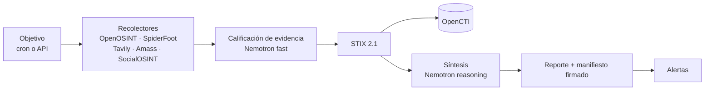
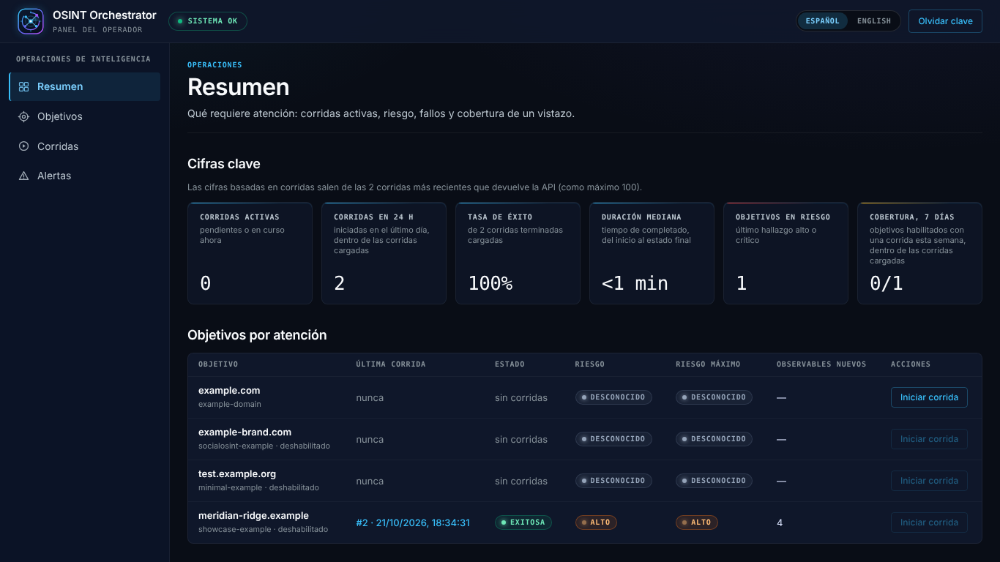
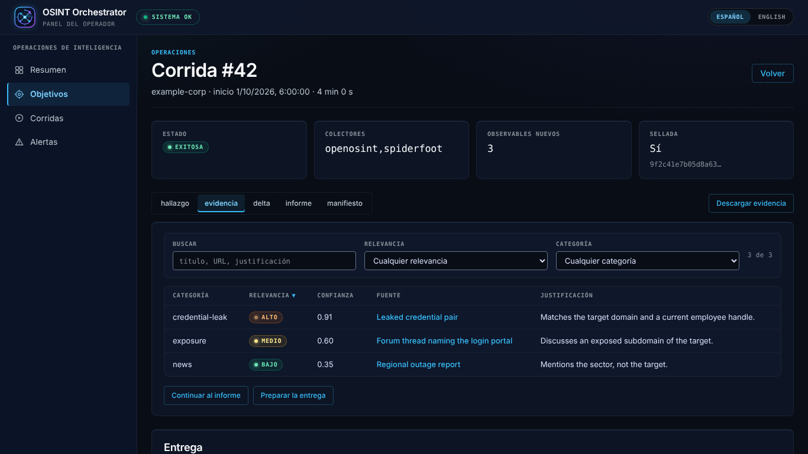
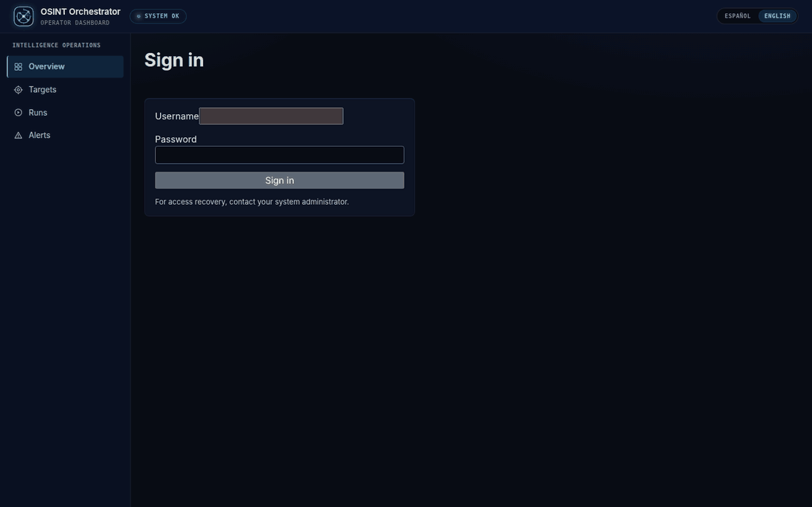
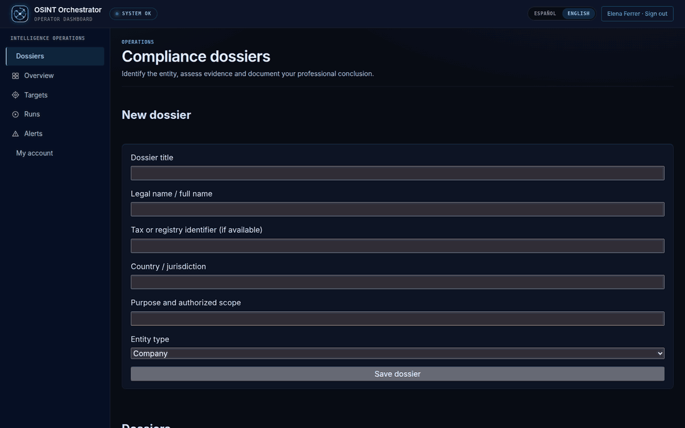
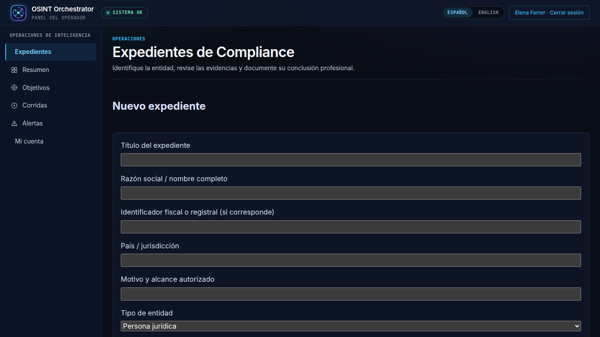
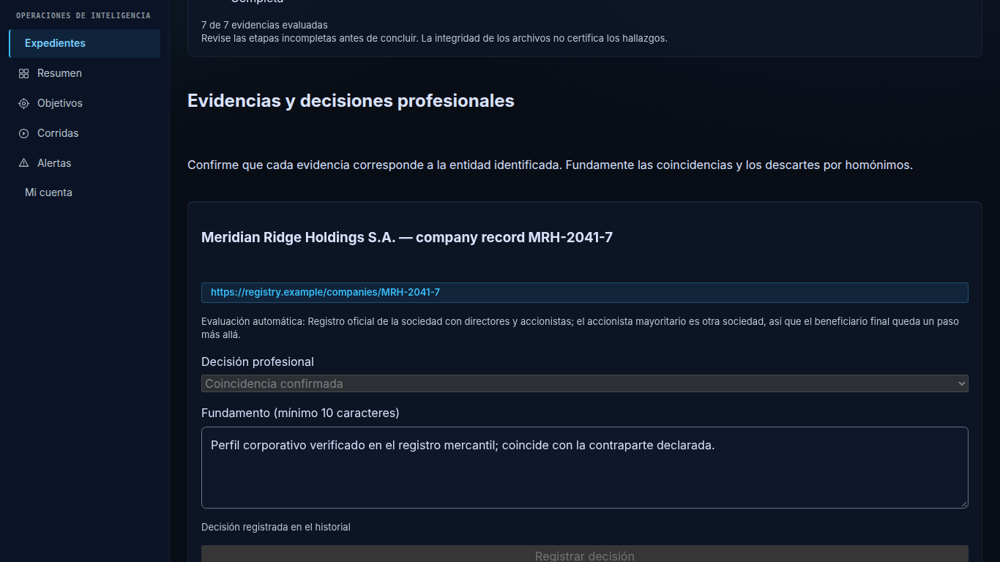
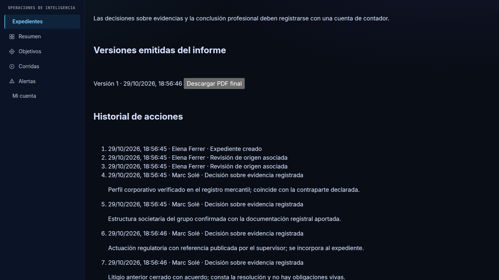
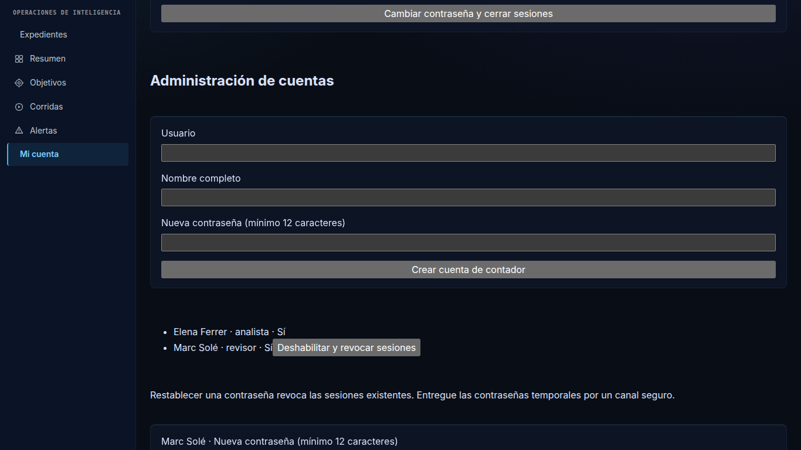

# OSINT Orchestrator

[](https://github.com/careb36/osint-orchestrator-oss/actions/workflows/ci.yml)
[](LICENSE)

> [English](README.md)

Debida diligencia en fuentes abiertas para equipos de cumplimiento PLA/FT y
sujetos obligados no financieros: investiga una entidad en fuentes públicas,
califica lo que encuentra con NVIDIA Nemotron en Nebius Token Factory y deja un
reporte firmado y auditable.

## El problema

La debida diligencia en fuentes abiertas se hace a mano: un analista busca en
registros, prensa y datos de infraestructura, copia los resultados a un
documento y escribe una conclusión. Es lenta, no escala a revisiones periódicas
y no deja rastro de qué fuentes se consultaron, qué decían ese día ni si el
archivo se modificó después.

## Cómo funciona



- **Recolectar.** Cada objetivo autorizado se investiga según un cron o a
  demanda. OpenOSINT y SpiderFoot corren para todo objetivo; Tavily, Amass y
  SocialOSINT se activan por objetivo, así que nada sale de su infraestructura
  ni llega a un tercero salvo que el bloque de ese objetivo lo pida.
- **Calificar.** Cada resultado web se clasifica respecto de la entidad:
  categoría (sanciones, litigios, prensa adversa…), relevancia, confianza y una
  justificación de una línea.
- **Normalizar.** Los hallazgos pasan a STIX 2.1 con ids determinísticos y se
  pueden ingestar en OpenCTI.
- **Sintetizar.** Un nivel de riesgo con su justificación, que cita la
  evidencia en la que se apoya, y qué es nuevo desde la corrida anterior.
- **Sellar.** Los archivos de cada corrida se resumen en un manifiesto firmado
  con HMAC y encadenado a la corrida anterior, de modo que cualquier edición o
  borrado posterior se detecta.

| Colector | Cómo corre | Activo por defecto | Qué aporta |
| --- | --- | --- | --- |
| OpenOSINT | búsqueda de pivotes en proceso, con presupuestos duros | todo objetivo | Dominios, URL y entidades alcanzadas desde la semilla |
| SpiderFoot | en el stack base, por HTTP | todo objetivo | Hosts, certificados y exposiciones de sus módulos |
| Tavily | API de búsqueda alojada, requiere `TAVILY_API_KEY` | opt-in por objetivo | Páginas de terceros como observables `url`, cada una calificada |
| Amass | CLI sidecar, `--profile amass` | opt-in por objetivo | Subdominios y sus registros DNS |
| SocialOSINT | REST sidecar, `--profile socialosint` | opt-in por objetivo | Un `user-account` por handle, más una nota de análisis sin verificar |

Las claves por colector (`collectors.<nombre>.*`) están en
[configuración](docs/configuration.md) (en inglés).

Detalle: [arquitectura](docs/architecture.md) (en inglés).

## NVIDIA Nemotron en Nebius Token Factory

Un objetivo elige el endpoint compatible con OpenAI de Token Factory con
`llm: nebius` en `targets.yaml` (o con `llm: openai` cuando
`LLM_PROVIDER=nebius`). Por defecto los objetivos tienen `llm: local`, que
envía los prompts del LLM al servidor Ollama de `LLM_BASE_URL` y nunca a un
proveedor de LLM en la nube; los prompts quedan en tu infraestructura solo si
ese servidor está en ella. Hay dos rutas de modelo que se configuran por
separado:

| Ruta | Variable | Modelo usado en nuestras corridas | Tarea | Código |
| --- | --- | --- | --- | --- |
| fast | `LLM_MODEL_FAST` | `nvidia/NVIDIA-Nemotron-3-Nano-30B-A3B` | Calificar cada resultado web respecto de la entidad | [`synthesizer/qualify.py`](orchestrator/synthesizer/qualify.py) |
| reasoning | `LLM_MODEL_REASONING` | `nvidia/nemotron-3-super-120b-a12b` | Síntesis de riesgo de la corrida | [`synthesizer/__init__.py`](orchestrator/synthesizer/__init__.py) |

Las dos llamadas piden una respuesta con esquema JSON, se reintentan dentro de
un presupuesto de tiempo, y cada valor devuelto se valida antes de guardarse.
La comprobación al arrancar de que el proveedor sirve los modelos configurados
depende del ajuste global, no del `llm` del objetivo: solo se ejecuta con
`LLM_PROVIDER=nebius` u `openai` y la clave de ese proveedor definida, de modo
que un despliegue que solo pone `llm: nebius` en el objetivo no tiene esa
comprobación. Las
peticiones, los tokens y la disponibilidad de los modelos se exportan como
métricas Prometheus. Cliente del proveedor:
[`providers/openai_compat.py`](orchestrator/synthesizer/providers/openai_compat.py).

### Correrlo en Token Factory

Cuatro líneas en `.env`, y `llm: nebius` en cada objetivo de `targets.yaml`:

```bash
LLM_PROVIDER=nebius
NEBIUS_API_KEY=<tu clave de Token Factory>
LLM_MODEL_FAST=nvidia/NVIDIA-Nemotron-3-Nano-30B-A3B
LLM_MODEL_REASONING=nvidia/nemotron-3-super-120b-a12b
```

`LLM_PROVIDER=nebius` además activa la comprobación al arrancar de que los dos
modelos están servidos y manda los objetivos con `llm: openai` a Token Factory.
Sin las dos líneas `LLM_MODEL_*`, ambas rutas usan `LLM_MODEL`, cuyo valor por
defecto, `llama3.2`, nombra un modelo de Ollama, no uno de Token Factory.

## Tavily

El recolector de Tavily ([`collectors/tavily.py`](orchestrator/collectors/tavily.py))
llama a la API de búsqueda en tiempo de ejecución con cinco consultas de debida
diligencia por término: prensa adversa y sanciones, estructura societaria,
procesos judiciales, antecedente penal y sanción administrativa, sin filtro
temporal. Los términos son los nombres de la entidad configurados
para el objetivo (por defecto, el dominio), entre comillas y buscados en
fuentes de terceros. Cada página distinta genera un observable STIX `url` y una
Nota, es calificada por Nemotron y queda registrada en
`qualified_evidence.json`, cubierta por el manifiesto firmado de la corrida.

## Inicio rápido

Tres caminos, desde ninguna clave hasta el stack completo. Todos necesitan
Docker con Compose v2.20+ y empiezan igual:

```bash
cp .env.example .env                    # contraseñas, tokens y API keys que lista
cp targets.example.yaml targets.yaml    # solo objetivos que esté autorizado a evaluar
docker compose up -d --build            # SpiderFoot y el orquestador (OPENCTI_ENABLED=false)
```

Después, ver [operación](docs/operations.md), [configuración](docs/configuration.md)
y, para un servidor, [despliegue](docs/deploy.md) (en inglés).

### 1. Verlo primero: la corrida de muestra (sin claves de API)

Antes de configurar un colector o un proveedor de modelos, reproduzca la
muestra grabada con el pipeline real y abra la consola con dos corridas
terminadas:

```bash
docker compose exec orchestrator python -m orchestrator.showcase
# después, http://localhost:8000/console
```

El contenedor escribe los informes en `./daily_reports` como uid 1000; el
directorio viene en el clon para que Docker no lo cree como root. En Linux, si
su usuario no es el uid 1000, ejecute antes `sudo chown -R 1000:1000
daily_reports` ([despliegue](docs/deploy.md), en inglés).

La muestra reproduce [`orchestrator/showcase_data/`](orchestrator/showcase_data/):
una entidad ficticia (nombres `.example` reservados, direcciones TEST-NET)
evaluada dos veces; la segunda corrida añade una entrada en una lista de
sanciones y una investigación sobre la propiedad. Solo están grabados la
salida de los colectores y las respuestas del modelo; la normalización a STIX,
el delta respecto de la primera corrida, el informe, `qualified_evidence.json`,
el manifiesto firmado y encadenado y el caso de alerta los produce en su
máquina el mismo código que usa una corrida programada. Las filas dicen
proveedor `showcase` y modelo `recorded-sample`: la consola nunca atribuye a
un modelo algo que no ejecutó. El objetivo `showcase-example` viene con
`enabled: false`: el planificador no lo ejecuta y no cuesta ninguna llamada.
Detalles en [operación](docs/operations.md#showcase-run) (en inglés).

### 2. Una corrida real con dos claves (Token Factory y Tavily)

El camino en vivo más corto es Tavily → Nemotron: evidencia web recolectada
en el momento, calificada en la ruta rápida y sintetizada en la ruta de
razonamiento, sin escaneo de SpiderFoot y sin OpenCTI. En `.env`, las cuatro
líneas de Token Factory de [Correrlo en Token Factory](#correrlo-en-token-factory)
más la clave de búsqueda:

```bash
NEBIUS_API_KEY=<su clave de Token Factory>
TAVILY_API_KEY=<su clave de Tavily>
```

En `targets.yaml`, copie el bloque `showcase-example` con un **`id` nuevo**
(las corridas, los observables vistos y el historial de riesgo de la muestra
quedan con la muestra; una entidad real no debe heredarlos), ponga
`enabled: true` y reemplace `fqdn` y `search_terms` por una entidad que esté
autorizado a evaluar; deje `openosint` y `spiderfoot` desactivados, como
vienen en el bloque, y no toque el bloque de la muestra. Reinicie el
orquestador para que lea las claves (`docker compose up -d orchestrator`;
`targets.yaml` se lee en cada petición) e inicie la corrida desde el botón
*Iniciar corrida* de la consola o con `POST /targets/<id>/run`. Una corrida
tarda alrededor de un minuto; la consola muestra qué modelo calificó cada
evidencia y cuál escribió el hallazgo.

### 3. El stack completo

OpenCTI como grafo de conocimiento, SpiderFoot y OpenOSINT como colectores,
corridas programadas y alertas: 16 GB de RAM, `OPENCTI_ENABLED=true` en `.env`
y el perfil en la línea de comandos:

```bash
docker compose --profile opencti up -d --build
```

Las instalaciones existentes con el sink activo deben añadir
`--profile opencti` o definir `COMPOSE_PROFILES=opencti` en `.env`.

**Panel del operador:** <http://localhost:8000/console>, en español o inglés.
Cifras clave, objetivos ordenados por lo que requiere atención, corridas
activas, hallazgos, evidencia con búsqueda y filtros, y un botón para iniciar
corridas; pide `ORCHESTRATOR_API_KEY` al abrirlo. Código en
[`ui/`](ui/README.md) (en inglés); las imágenes lo construyen solas.

Las dos capturas son la consola tras la repetición de la muestra (paso 1 del
inicio rápido): la entidad ficticia, dos corridas, sin clave de API.





Los dos clips siguientes son capturas sin montaje de esa misma repetición:
entrar, leer qué requiere atención, abrir una corrida y seguir un expediente de
debida diligencia desde la evidencia grabada hasta el informe firmado. Nada está
preparado para la cámara; la consola es la que se obtiene con el inicio rápido.





## Uso responsable

El orquestador ejecuta reconocimiento contra lo que figure en `targets.yaml`, y
algunos recolectores hacen peticiones en vivo al objetivo. Agregue solo
objetivos propios o que esté autorizado por escrito a evaluar; `authorization`
y `purpose` son obligatorios por objetivo y se escriben en cada reporte. La
salida de los modelos es una ayuda para el analista, no una determinación. Ver
[SECURITY](SECURITY.md).

## Hoja de ruta

| Ítem | Estado |
| --- | --- |
| Calificación de evidencia y cadena de evidencia | Hecho |
| Panel del operador (resumen, triaje, investigación) | Hecho |
| Expedientes de cumplimiento: roles, decisiones fundamentadas, informes firmados versionados | Hecho |
| Calificación de relaciones entre entidades | Planificado |
| Indicadores de calidad de datos por fuente | Planificado |
| NLP de documentos (balances, expedientes) | Planificado |
| Fuentes autoritativas (registros, listas de sanciones) | Planificado |

## Revisiones profesionales de Compliance

El acceso personal distingue contadores y administración. Los expedientes conservan decisiones fundamentadas por evidencia e informes finales versionados. Consulte el [flujo profesional](docs/compliance-workflow.md) (en inglés); las claves de automatización conservan sus permisos y deben rotarse si antes se compartieron con operadores.

Un expediente conserva las corridas en que se basa, el motivo de cada ítem
confirmado o descartado y cada versión del informe, de modo que el archivo se
pueda defender después. Las decisiones y la conclusión las registra una cuenta
de contador, nunca la administración que creó el expediente.









## Documentación

La documentación de referencia está disponible en inglés y español:
[Arquitectura](docs/architecture.md) · [Configuración](docs/configuration.md) ·
[Operación](docs/operations.md) · [Despliegue](docs/deploy.md) · [Decisiones](docs/adr/) ·
[Contribuir](CONTRIBUTING.md) · [Seguridad](SECURITY.md) ·
[Changelog](CHANGELOG.md) · [Historial de la hackathon](docs/HACKATHON.md)

Licencia MIT — ver [LICENSE](LICENSE).
