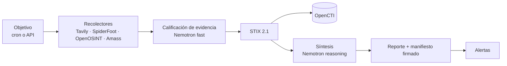

# OSINT Orchestrator

> [English](README.md)

Debida diligencia en fuentes abiertas para equipos de cumplimiento PLA/FT y
sujetos obligados no financieros: investiga una entidad en fuentes públicas,
califica lo que encuentra con NVIDIA Nemotron en Nebius Token Factory y deja un
reporte firmado y auditable.

## El problema

La debida diligencia en fuentes abiertas se hace a mano: un analista busca en
registros, prensa y datos de infraestructura, copia los resultados a un
documento y escribe una conclusión. Es lenta, no escala a revisiones periódicas
y no deja rastro de qué fuentes se consultaron, qué decían ese día ni si el
archivo se modificó después.

## Cómo funciona



- **Recolectar.** Cada objetivo autorizado se investiga según un cron o a
  demanda, con búsqueda web (Tavily) y recolectores de infraestructura.
- **Calificar.** Cada resultado web se clasifica respecto de la entidad:
  categoría (sanciones, litigios, prensa adversa…), relevancia, confianza y una
  justificación de una línea.
- **Normalizar.** Los hallazgos pasan a STIX 2.1 con ids determinísticos y se
  pueden ingestar en OpenCTI.
- **Sintetizar.** Un nivel de riesgo con su justificación, que cita la
  evidencia en la que se apoya, y qué es nuevo desde la corrida anterior.
- **Sellar.** Los archivos de cada corrida se resumen en un manifiesto firmado
  con HMAC y encadenado a la corrida anterior, de modo que cualquier edición o
  borrado posterior se detecta.

Detalle: [arquitectura](docs/architecture.md) (en inglés).

## NVIDIA Nemotron en Nebius Token Factory

`LLM_PROVIDER=nebius` usa el endpoint compatible con OpenAI de Token Factory.
Hay dos rutas de modelo que se configuran por separado:

| Ruta | Variable | Modelo usado en nuestras corridas | Tarea | Código |
| --- | --- | --- | --- | --- |
| fast | `LLM_MODEL_FAST` | `nvidia/NVIDIA-Nemotron-3-Nano-30B-A3B` | Calificar cada resultado web respecto de la entidad | [`synthesizer/qualify.py`](orchestrator/synthesizer/qualify.py) |
| reasoning | `LLM_MODEL_REASONING` | `nvidia/nemotron-3-super-120b-a12b` | Síntesis de riesgo de la corrida | [`synthesizer/__init__.py`](orchestrator/synthesizer/__init__.py) |

Las dos llamadas piden una respuesta con esquema JSON, se reintentan dentro de
un presupuesto de tiempo, y cada valor devuelto se valida antes de guardarse.
Al arrancar, el servicio comprueba que el proveedor sirve los modelos
configurados. Las peticiones, los tokens y la disponibilidad de los modelos se
exportan como métricas Prometheus. Cliente del proveedor:
[`providers/openai_compat.py`](orchestrator/synthesizer/providers/openai_compat.py).

## Tavily

El recolector de Tavily ([`collectors/tavily.py`](orchestrator/collectors/tavily.py))
llama a la API de búsqueda en tiempo de ejecución con tres consultas de debida
diligencia por término: prensa adversa y sanciones, estructura societaria, y
procesos judiciales. Los términos son los nombres de la entidad configurados
para el objetivo (por defecto, el dominio), entre comillas y buscados en
fuentes de terceros. Cada página distinta genera un observable STIX `url` y una
Nota, es calificada por Nemotron y queda registrada en
`qualified_evidence.json`, cubierta por el manifiesto firmado de la corrida.

## Inicio rápido

El stack completo (OpenCTI, SpiderFoot, corridas programadas, alertas) necesita
Docker con Compose v2 y 16 GB de RAM:

```bash
cp .env.example .env                    # contraseñas, tokens y API keys que lista
cp targets.example.yaml targets.yaml    # solo objetivos que esté autorizado a evaluar
docker compose up -d --build
```

Después, ver [operación](docs/operations.md), [configuración](docs/configuration.md)
y, para un servidor, [despliegue](docs/deploy.md) (en inglés).

**Panel del operador:** <http://localhost:8000/console>, en español o inglés.
Cifras clave, objetivos ordenados por lo que requiere atención, corridas
activas, hallazgos, evidencia con búsqueda y filtros, y un botón para iniciar
corridas; pide `ORCHESTRATOR_API_KEY` al abrirlo. Código en
[`ui/`](ui/README.md) (en inglés); las imágenes lo construyen solas.

## Construido durante el hackathon

El commit `Baseline: pre-hackathon snapshot` marca lo que existía antes: el
pipeline de recolección, la normalización a STIX, la ingesta en OpenCTI, los
reportes, las alertas y la API. Agregado desde entonces:

| Funcionalidad | Pull requests |
| --- | --- |
| Proveedor Nebius Token Factory, rutas de modelo reasoning y fast, reintentos acotados | [#1](https://github.com/careb36/osint-orchestrator-oss/pull/1), [#4](https://github.com/careb36/osint-orchestrator-oss/pull/4) |
| Recolector de investigación web con Tavily, búsqueda por nombre de entidad | [#2](https://github.com/careb36/osint-orchestrator-oss/pull/2), [#3](https://github.com/careb36/osint-orchestrator-oss/pull/3), [#13](https://github.com/careb36/osint-orchestrator-oss/pull/13) |
| Calificación de evidencia con Nemotron, incorporada a la síntesis | [#29](https://github.com/careb36/osint-orchestrator-oss/pull/29), [#30](https://github.com/careb36/osint-orchestrator-oss/pull/30) |
| Cadena de evidencia firmada, un directorio por corrida | [#23](https://github.com/careb36/osint-orchestrator-oss/pull/23), [#26](https://github.com/careb36/osint-orchestrator-oss/pull/26) |
| Comprobación al arrancar de que los modelos configurados están disponibles | [#25](https://github.com/careb36/osint-orchestrator-oss/pull/25) |
| Operación sin OpenCTI (`OPENCTI_ENABLED=false`) | [#23](https://github.com/careb36/osint-orchestrator-oss/pull/23) |
| Correcciones encontradas corriendo el stack de punta a punta; prueba de humo de la imagen en CI | [#6](https://github.com/careb36/osint-orchestrator-oss/pull/6), [#16](https://github.com/careb36/osint-orchestrator-oss/pull/16), [#19](https://github.com/careb36/osint-orchestrator-oss/pull/19) |
| Dashboard de operador (React): shell, vista general, triaje de targets y corridas, espacio de trabajo de la corrida con evidencia, reporte, manifiesto y exportación para entrega, historial de corridas, español e inglés, comprobaciones de accesibilidad | [#67](https://github.com/careb36/osint-orchestrator-oss/pull/67), [#68](https://github.com/careb36/osint-orchestrator-oss/pull/68), [#69](https://github.com/careb36/osint-orchestrator-oss/pull/69), [#70](https://github.com/careb36/osint-orchestrator-oss/pull/70), [#71](https://github.com/careb36/osint-orchestrator-oss/pull/71), [#75](https://github.com/careb36/osint-orchestrator-oss/pull/75), [#76](https://github.com/careb36/osint-orchestrator-oss/pull/76), [#77](https://github.com/careb36/osint-orchestrator-oss/pull/77) |
| Andamiaje del dashboard, alcance, KPIs y definición de hecho; telemetría de preparación para producción y flujo de humo | [#45](https://github.com/careb36/osint-orchestrator-oss/pull/45), [#47](https://github.com/careb36/osint-orchestrator-oss/pull/47), [#57](https://github.com/careb36/osint-orchestrator-oss/pull/57), [#58](https://github.com/careb36/osint-orchestrator-oss/pull/58), [#60](https://github.com/careb36/osint-orchestrator-oss/pull/60), [#61](https://github.com/careb36/osint-orchestrator-oss/pull/61), [#62](https://github.com/careb36/osint-orchestrator-oss/pull/62), [#64](https://github.com/careb36/osint-orchestrator-oss/pull/64) |
| Modo demo público, retirado después junto con la consola renderizada en el servidor | [#33](https://github.com/careb36/osint-orchestrator-oss/pull/33), [#35](https://github.com/careb36/osint-orchestrator-oss/pull/35), [#65](https://github.com/careb36/osint-orchestrator-oss/pull/65), [#73](https://github.com/careb36/osint-orchestrator-oss/pull/73), [#74](https://github.com/careb36/osint-orchestrator-oss/pull/74) |
| Correcciones de integridad (cadena de evidencia, retención) y endurecimiento del texto del modelo y de internet | [#66](https://github.com/careb36/osint-orchestrator-oss/pull/66), [#78](https://github.com/careb36/osint-orchestrator-oss/pull/78) |

## Uso responsable

El orquestador ejecuta reconocimiento contra lo que figure en `targets.yaml`, y
algunos recolectores hacen peticiones en vivo al objetivo. Agregue solo
objetivos propios o que esté autorizado por escrito a evaluar; `authorization`
y `purpose` son obligatorios por objetivo y se escriben en cada reporte. La
salida de los modelos es una ayuda para el analista, no una determinación. Ver
[SECURITY](SECURITY.md).

## Hoja de ruta

| Ítem | Estado |
| --- | --- |
| Calificación de evidencia y cadena de evidencia | Hecho |
| Panel del operador (resumen, triaje, investigación) | Hecho |
| Calificación de relaciones entre entidades | Planificado |
| Indicadores de calidad de datos por fuente | Planificado |
| NLP de documentos (balances, expedientes) | Planificado |
| Fuentes autoritativas (registros, listas de sanciones) | Planificado |

## Documentación

La documentación de referencia está en inglés:
[Arquitectura](docs/architecture.md) · [Configuración](docs/configuration.md) ·
[Operación](docs/operations.md) · [Despliegue](docs/deploy.md) · [Decisiones](docs/adr/) ·
[Contribuir](CONTRIBUTING.md) · [Seguridad](SECURITY.md) ·
[Changelog](CHANGELOG.md)

Licencia MIT — ver [LICENSE](LICENSE).
