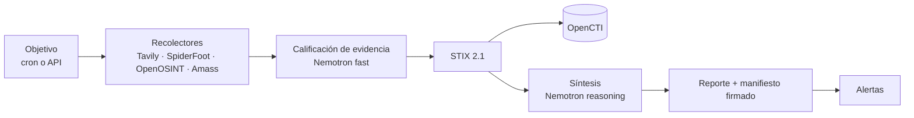

# OSINT Orchestrator

> [English](README.md)

Debida diligencia en fuentes abiertas para equipos de cumplimiento PLA/FT y
sujetos obligados no financieros: investiga una entidad en fuentes públicas,
califica lo que encuentra con NVIDIA Nemotron en Nebius Token Factory y deja un
reporte firmado y auditable.

## El problema

La debida diligencia en fuentes abiertas se hace a mano: un analista busca en
registros, prensa y datos de infraestructura, copia los resultados a un
documento y escribe una conclusión. Es lenta, no escala a revisiones periódicas
y no deja rastro de qué fuentes se consultaron, qué decían ese día ni si el
archivo se modificó después.

## Cómo funciona



- **Recolectar.** Cada objetivo autorizado se investiga según un cron o a
  demanda, con búsqueda web (Tavily) y recolectores de infraestructura.
- **Calificar.** Cada resultado web se clasifica respecto de la entidad:
  categoría (sanciones, litigios, prensa adversa…), relevancia, confianza y una
  justificación de una línea.
- **Normalizar.** Los hallazgos pasan a STIX 2.1 con ids determinísticos y se
  pueden ingestar en OpenCTI.
- **Sintetizar.** Un nivel de riesgo con su justificación, que cita la
  evidencia en la que se apoya, y qué es nuevo desde la corrida anterior.
- **Sellar.** Los archivos de cada corrida se resumen en un manifiesto firmado
  con HMAC y encadenado a la corrida anterior, de modo que cualquier edición o
  borrado posterior se detecta.

Detalle: [arquitectura](docs/architecture.md) (en inglés).

## NVIDIA Nemotron en Nebius Token Factory

Un objetivo elige el endpoint compatible con OpenAI de Token Factory con
`llm: nebius` en `targets.yaml` (o con `llm: openai` cuando
`LLM_PROVIDER=nebius`). Por defecto los objetivos tienen `llm: local`, que
envía los prompts del LLM al servidor Ollama de `LLM_BASE_URL` y nunca a un
proveedor de LLM en la nube; los prompts quedan en tu infraestructura solo si
ese servidor está en ella. Hay dos rutas de modelo que se configuran por
separado:

| Ruta | Variable | Modelo usado en nuestras corridas | Tarea | Código |
| --- | --- | --- | --- | --- |
| fast | `LLM_MODEL_FAST` | `nvidia/NVIDIA-Nemotron-3-Nano-30B-A3B` | Calificar cada resultado web respecto de la entidad | [`synthesizer/qualify.py`](orchestrator/synthesizer/qualify.py) |
| reasoning | `LLM_MODEL_REASONING` | `nvidia/nemotron-3-super-120b-a12b` | Síntesis de riesgo de la corrida | [`synthesizer/__init__.py`](orchestrator/synthesizer/__init__.py) |

Las dos llamadas piden una respuesta con esquema JSON, se reintentan dentro de
un presupuesto de tiempo, y cada valor devuelto se valida antes de guardarse.
La comprobación al arrancar de que el proveedor sirve los modelos configurados
depende del ajuste global, no del `llm` del objetivo: solo se ejecuta con
`LLM_PROVIDER=nebius` u `openai` y la clave de ese proveedor definida, de modo
que un despliegue que solo pone `llm: nebius` en el objetivo no tiene esa
comprobación. Las
peticiones, los tokens y la disponibilidad de los modelos se exportan como
métricas Prometheus. Cliente del proveedor:
[`providers/openai_compat.py`](orchestrator/synthesizer/providers/openai_compat.py).

### Correrlo en Token Factory

Cuatro líneas en `.env`, y `llm: nebius` en cada objetivo de `targets.yaml`:

```bash
LLM_PROVIDER=nebius
NEBIUS_API_KEY=<tu clave de Token Factory>
LLM_MODEL_FAST=nvidia/NVIDIA-Nemotron-3-Nano-30B-A3B
LLM_MODEL_REASONING=nvidia/nemotron-3-super-120b-a12b
```

`LLM_PROVIDER=nebius` además activa la comprobación al arrancar de que los dos
modelos están servidos y manda los objetivos con `llm: openai` a Token Factory.
Sin las dos líneas `LLM_MODEL_*`, ambas rutas usan `LLM_MODEL`, cuyo valor por
defecto, `llama3.2`, nombra un modelo de Ollama, no uno de Token Factory.

## Tavily

El recolector de Tavily ([`collectors/tavily.py`](orchestrator/collectors/tavily.py))
llama a la API de búsqueda en tiempo de ejecución con tres consultas de debida
diligencia por término: prensa adversa y sanciones, estructura societaria, y
procesos judiciales. Los términos son los nombres de la entidad configurados
para el objetivo (por defecto, el dominio), entre comillas y buscados en
fuentes de terceros. Cada página distinta genera un observable STIX `url` y una
Nota, es calificada por Nemotron y queda registrada en
`qualified_evidence.json`, cubierta por el manifiesto firmado de la corrida.

## Inicio rápido

Tres caminos, desde ninguna clave hasta el stack completo. Todos necesitan
Docker con Compose v2.20+ y empiezan igual:

```bash
cp .env.example .env                    # contraseñas, tokens y API keys que lista
cp targets.example.yaml targets.yaml    # solo objetivos que esté autorizado a evaluar
docker compose up -d --build            # SpiderFoot y el orquestador (OPENCTI_ENABLED=false)
```

Después, ver [operación](docs/operations.md), [configuración](docs/configuration.md)
y, para un servidor, [despliegue](docs/deploy.md) (en inglés).

### 1. Verlo primero: la corrida de muestra (sin claves de API)

Antes de configurar un colector o un proveedor de modelos, reproduzca la
muestra grabada con el pipeline real y abra la consola con dos corridas
terminadas:

```bash
docker compose exec orchestrator python -m orchestrator.showcase
# después, http://localhost:8000/console
```

El contenedor escribe los informes en `./daily_reports` como uid 1000; el
directorio viene en el clon para que Docker no lo cree como root. En Linux, si
su usuario no es el uid 1000, ejecute antes `sudo chown -R 1000:1000
daily_reports` ([despliegue](docs/deploy.md), en inglés).

La muestra reproduce [`orchestrator/showcase_data/`](orchestrator/showcase_data/):
una entidad ficticia (nombres `.example` reservados, direcciones TEST-NET)
evaluada dos veces; la segunda corrida añade una entrada en una lista de
sanciones y una investigación sobre la propiedad. Solo están grabados la
salida de los colectores y las respuestas del modelo; la normalización a STIX,
el delta respecto de la primera corrida, el informe, `qualified_evidence.json`,
el manifiesto firmado y encadenado y el caso de alerta los produce en su
máquina el mismo código que usa una corrida programada. Las filas dicen
proveedor `showcase` y modelo `recorded-sample`: la consola nunca atribuye a
un modelo algo que no ejecutó. El objetivo `showcase-example` viene con
`enabled: false`: el planificador no lo ejecuta y no cuesta ninguna llamada.
Detalles en [operación](docs/operations.md#showcase-run) (en inglés).

### 2. Una corrida real con dos claves (Token Factory y Tavily)

El camino en vivo más corto es Tavily → Nemotron: evidencia web recolectada
en el momento, calificada en la ruta rápida y sintetizada en la ruta de
razonamiento, sin escaneo de SpiderFoot y sin OpenCTI. En `.env`, las cuatro
líneas de Token Factory de [Correrlo en Token Factory](#correrlo-en-token-factory)
más la clave de búsqueda:

```bash
NEBIUS_API_KEY=<su clave de Token Factory>
TAVILY_API_KEY=<su clave de Tavily>
```

En `targets.yaml`, copie el bloque `showcase-example` con un **`id` nuevo**
(las corridas, los observables vistos y el historial de riesgo de la muestra
quedan con la muestra; una entidad real no debe heredarlos), ponga
`enabled: true` y reemplace `fqdn` y `search_terms` por una entidad que esté
autorizado a evaluar; deje `openosint` y `spiderfoot` desactivados, como
vienen en el bloque, y no toque el bloque de la muestra. Reinicie el
orquestador para que lea las claves (`docker compose up -d orchestrator`;
`targets.yaml` se lee en cada petición) e inicie la corrida desde el botón
*Iniciar corrida* de la consola o con `POST /targets/<id>/run`. Una corrida
tarda alrededor de un minuto; la consola muestra qué modelo calificó cada
evidencia y cuál escribió el hallazgo.

### 3. El stack completo

OpenCTI como grafo de conocimiento, SpiderFoot y OpenOSINT como colectores,
corridas programadas y alertas: 16 GB de RAM, `OPENCTI_ENABLED=true` en `.env`
y el perfil en la línea de comandos:

```bash
docker compose --profile opencti up -d --build
```

Las instalaciones existentes con el sink activo deben añadir
`--profile opencti` o definir `COMPOSE_PROFILES=opencti` en `.env`.

**Panel del operador:** <http://localhost:8000/console>, en español o inglés.
Cifras clave, objetivos ordenados por lo que requiere atención, corridas
activas, hallazgos, evidencia con búsqueda y filtros, y un botón para iniciar
corridas; pide `ORCHESTRATOR_API_KEY` al abrirlo. Código en
[`ui/`](ui/README.md) (en inglés); las imágenes lo construyen solas.

Las dos capturas son la consola tras la corrida de muestra del nivel 1: la
entidad ficticia, dos corridas, ninguna clave de API.


## Construido durante el hackathon

El commit `Baseline: pre-hackathon snapshot` marca lo que existía antes: el
pipeline de recolección, la normalización a STIX, la ingesta en OpenCTI, los
reportes, las alertas y la API. Agregado desde entonces:

| Funcionalidad | Pull requests |
| --- | --- |
| Proveedor Nebius Token Factory, rutas de modelo reasoning y fast, reintentos acotados | [#1](https://github.com/careb36/osint-orchestrator-oss/pull/1), [#4](https://github.com/careb36/osint-orchestrator-oss/pull/4) |
| Recolector de investigación web con Tavily, búsqueda por nombre de entidad | [#2](https://github.com/careb36/osint-orchestrator-oss/pull/2), [#3](https://github.com/careb36/osint-orchestrator-oss/pull/3), [#13](https://github.com/careb36/osint-orchestrator-oss/pull/13) |
| Calificación de evidencia con Nemotron, incorporada a la síntesis | [#29](https://github.com/careb36/osint-orchestrator-oss/pull/29), [#30](https://github.com/careb36/osint-orchestrator-oss/pull/30) |
| Cadena de evidencia firmada, un directorio por corrida | [#23](https://github.com/careb36/osint-orchestrator-oss/pull/23), [#26](https://github.com/careb36/osint-orchestrator-oss/pull/26) |
| Comprobación al arrancar de que los modelos configurados están disponibles | [#25](https://github.com/careb36/osint-orchestrator-oss/pull/25) |
| Operación sin OpenCTI (`OPENCTI_ENABLED=false`) | [#23](https://github.com/careb36/osint-orchestrator-oss/pull/23) |
| Correcciones encontradas corriendo el stack de punta a punta; prueba de humo de la imagen en CI | [#6](https://github.com/careb36/osint-orchestrator-oss/pull/6), [#16](https://github.com/careb36/osint-orchestrator-oss/pull/16), [#19](https://github.com/careb36/osint-orchestrator-oss/pull/19) |
| Dashboard de operador (React): shell, vista general, triaje de targets y corridas, espacio de trabajo de la corrida con evidencia, reporte, manifiesto y exportación para entrega, historial de corridas, español e inglés, comprobaciones de accesibilidad | [#67](https://github.com/careb36/osint-orchestrator-oss/pull/67), [#68](https://github.com/careb36/osint-orchestrator-oss/pull/68), [#69](https://github.com/careb36/osint-orchestrator-oss/pull/69), [#70](https://github.com/careb36/osint-orchestrator-oss/pull/70), [#71](https://github.com/careb36/osint-orchestrator-oss/pull/71), [#75](https://github.com/careb36/osint-orchestrator-oss/pull/75), [#76](https://github.com/careb36/osint-orchestrator-oss/pull/76), [#77](https://github.com/careb36/osint-orchestrator-oss/pull/77) |
| Andamiaje del dashboard, alcance, KPIs y definición de hecho; telemetría de preparación para producción y flujo de humo | [#45](https://github.com/careb36/osint-orchestrator-oss/pull/45), [#47](https://github.com/careb36/osint-orchestrator-oss/pull/47), [#57](https://github.com/careb36/osint-orchestrator-oss/pull/57), [#58](https://github.com/careb36/osint-orchestrator-oss/pull/58), [#60](https://github.com/careb36/osint-orchestrator-oss/pull/60), [#61](https://github.com/careb36/osint-orchestrator-oss/pull/61), [#62](https://github.com/careb36/osint-orchestrator-oss/pull/62), [#64](https://github.com/careb36/osint-orchestrator-oss/pull/64) |
| Modo demo público, retirado después junto con la consola renderizada en el servidor | [#33](https://github.com/careb36/osint-orchestrator-oss/pull/33), [#35](https://github.com/careb36/osint-orchestrator-oss/pull/35), [#65](https://github.com/careb36/osint-orchestrator-oss/pull/65), [#73](https://github.com/careb36/osint-orchestrator-oss/pull/73), [#74](https://github.com/careb36/osint-orchestrator-oss/pull/74) |
| Correcciones de integridad (cadena de evidencia, retención) y endurecimiento del texto del modelo y de internet | [#66](https://github.com/careb36/osint-orchestrator-oss/pull/66), [#78](https://github.com/careb36/osint-orchestrator-oss/pull/78) |
| Casos de alerta con triaje de reconocer/resolver, regla on_run_failure y métricas; vista de Alertas en el dashboard | [#88](https://github.com/careb36/osint-orchestrator-oss/pull/88), [#89](https://github.com/careb36/osint-orchestrator-oss/pull/89) |
| Ingesta externa de STIX 2.1 (ADR-011): `POST /bundles` y la CLI `ingest_bundle` con validación de esquema; overlay del worker de investigation-assistant | [#92](https://github.com/careb36/osint-orchestrator-oss/pull/92), [#118](https://github.com/careb36/osint-orchestrator-oss/pull/118) |
| Correcciones en recolectores y normalizador: escaneos abandonados de SpiderFoot detenidos, OpenOSINT nunca lanza excepciones, ids de Note por target, segmentos de Tavily no falsificables | [#79](https://github.com/careb36/osint-orchestrator-oss/pull/79), [#80](https://github.com/careb36/osint-orchestrator-oss/pull/80) |
| API y salud: 404 en chain/verify para targets desconocidos, limit/offset en `GET /runs`, `GET /ready` para sondas, claves de firma retiradas aceptadas al verificar | [#81](https://github.com/careb36/osint-orchestrator-oss/pull/81), [#82](https://github.com/careb36/osint-orchestrator-oss/pull/82), [#83](https://github.com/careb36/osint-orchestrator-oss/pull/83) |
| Endurecimiento del despliegue: imagen como uid 1000, puertos de compose atados a loopback, tags fijadas, perfil de OpenCTI opcional y stack LTS, valores de Helm para los ajustes nuevos | [#84](https://github.com/careb36/osint-orchestrator-oss/pull/84), [#86](https://github.com/careb36/osint-orchestrator-oss/pull/86), [#107](https://github.com/careb36/osint-orchestrator-oss/pull/107), [#111](https://github.com/careb36/osint-orchestrator-oss/pull/111) |
| CI y cadena de suministro: workflow de release, análisis Trivy y SBOM en las imágenes, mypy bloqueante, limpieza de tipos, esquema STIX fijado | [#87](https://github.com/careb36/osint-orchestrator-oss/pull/87), [#90](https://github.com/careb36/osint-orchestrator-oss/pull/90), [#99](https://github.com/careb36/osint-orchestrator-oss/pull/99), [#100](https://github.com/careb36/osint-orchestrator-oss/pull/100), [#104](https://github.com/careb36/osint-orchestrator-oss/pull/104), [#105](https://github.com/careb36/osint-orchestrator-oss/pull/105) |
| Validación estricta de `targets.yaml`, corrección de la métrica de latencia, 404 en reportes purgados; ajustes muertos, docs obsoletas y un fallback inalcanzable eliminados | [#109](https://github.com/careb36/osint-orchestrator-oss/pull/109), [#110](https://github.com/careb36/osint-orchestrator-oss/pull/110), [#112](https://github.com/careb36/osint-orchestrator-oss/pull/112), [#117](https://github.com/careb36/osint-orchestrator-oss/pull/117) |
| Cobertura de pruebas del planificador, rutas de error del pipeline, proveedores LLM, calificación, cadena de evidencia, sumidero y normalizador; corrección del flujo de humo de la UI | [#94](https://github.com/careb36/osint-orchestrator-oss/pull/94), [#113](https://github.com/careb36/osint-orchestrator-oss/pull/113), [#114](https://github.com/careb36/osint-orchestrator-oss/pull/114), [#116](https://github.com/careb36/osint-orchestrator-oss/pull/116) |
| Rediseño Obsidian Sentinel del dashboard y la landing: barra de navegación, chip de salud en vivo, tarjetas responsivas, correcciones de accesibilidad; capturas en el README | [#119](https://github.com/careb36/osint-orchestrator-oss/pull/119), [#122](https://github.com/careb36/osint-orchestrator-oss/pull/122) |
| Modelo de amenazas OWASP pytm con informe triado y un registro de hallazgos verificado en cada regeneración | [#120](https://github.com/careb36/osint-orchestrator-oss/pull/120) |
| Corrida de muestra: dos corridas grabadas de una entidad ficticia reproducidas con el pipeline real, para que la consola enseñe el producto sin claves de API; un solo run activo por objetivo garantizado por la base de datos; inicio rápido en tres niveles | [#124](https://github.com/careb36/osint-orchestrator-oss/pull/124) |
| La pestaña de evidencia nombra el proveedor y el modelo que calificó cada fila | [#125](https://github.com/careb36/osint-orchestrator-oss/pull/125) |
| Documentación: bloque de configuración de Token Factory, enrutamiento de LLM explicado, reglas de agente por ruta, tablas del hackathon | [#85](https://github.com/careb36/osint-orchestrator-oss/pull/85), [#91](https://github.com/careb36/osint-orchestrator-oss/pull/91), [#115](https://github.com/careb36/osint-orchestrator-oss/pull/115), [#121](https://github.com/careb36/osint-orchestrator-oss/pull/121) |

## Uso responsable

El orquestador ejecuta reconocimiento contra lo que figure en `targets.yaml`, y
algunos recolectores hacen peticiones en vivo al objetivo. Agregue solo
objetivos propios o que esté autorizado por escrito a evaluar; `authorization`
y `purpose` son obligatorios por objetivo y se escriben en cada reporte. La
salida de los modelos es una ayuda para el analista, no una determinación. Ver
[SECURITY](SECURITY.md).

## Hoja de ruta

| Ítem | Estado |
| --- | --- |
| Calificación de evidencia y cadena de evidencia | Hecho |
| Panel del operador (resumen, triaje, investigación) | Hecho |
| Calificación de relaciones entre entidades | Planificado |
| Indicadores de calidad de datos por fuente | Planificado |
| NLP de documentos (balances, expedientes) | Planificado |
| Fuentes autoritativas (registros, listas de sanciones) | Planificado |

## Revisiones profesionales de Compliance

El acceso personal distingue contadores y administración. Los expedientes conservan decisiones fundamentadas por evidencia e informes finales versionados. Consulte el [flujo profesional](docs/compliance-workflow.md) (en inglés); las claves de automatización conservan sus permisos y deben rotarse si antes se compartieron con operadores.

## Documentación

La documentación de referencia está en inglés:
[Arquitectura](docs/architecture.md) · [Configuración](docs/configuration.md) ·
[Operación](docs/operations.md) · [Despliegue](docs/deploy.md) · [Decisiones](docs/adr/) ·
[Contribuir](CONTRIBUTING.md) · [Seguridad](SECURITY.md) ·
[Changelog](CHANGELOG.md)

Licencia MIT — ver [LICENSE](LICENSE).
