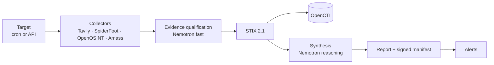
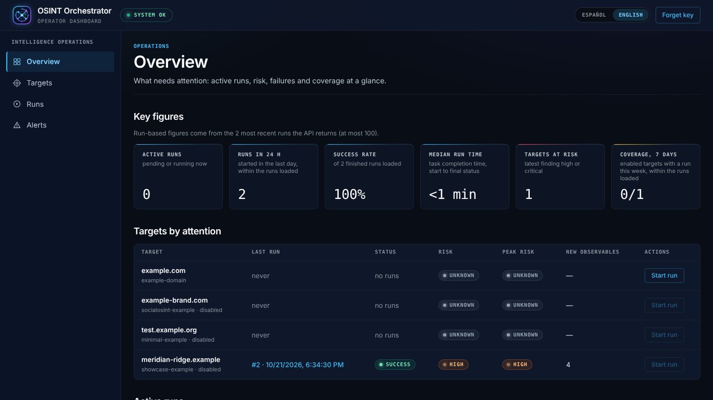
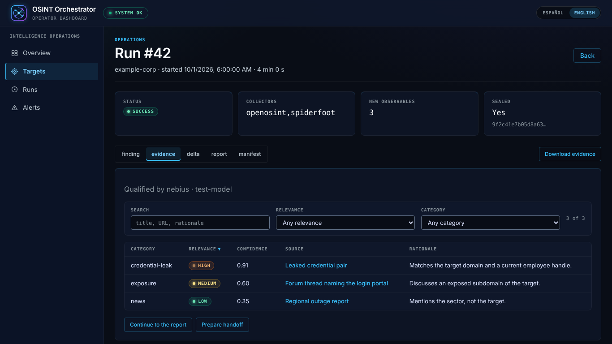

# OSINT Orchestrator

> [Español](README.es.md)

Open-source due diligence for AML/CFT compliance teams and non-financial
obliged entities: it researches an entity in public sources, qualifies what it
finds with NVIDIA Nemotron on Nebius Token Factory, and leaves a signed,
auditable report.

## The problem

Open-source due diligence is done by hand: an analyst searches registries, news
and infrastructure data, copies results into a document and writes a
conclusion. It is slow, it does not scale to periodic re-checks, and it leaves
no trail showing which sources were consulted, what they said that day, or
whether the file was edited afterwards.

## How it works



- **Collect.** Each authorised target is researched on a schedule or on demand
  by web search (Tavily) and infrastructure collectors.
- **Qualify.** Every web result is classified against the entity: category
  (sanctions, litigation, adverse media…), relevance, confidence and a one-line
  rationale.
- **Normalise.** Findings become STIX 2.1 with deterministic ids and can be
  ingested into OpenCTI.
- **Synthesise.** A risk level with its justification, citing the evidence it
  relies on, plus what is new since the previous run.
- **Seal.** Each run's files are hashed into an HMAC-signed manifest chained to
  the previous run, so any later edit or removal is detectable.

Details: [architecture](docs/architecture.md).

## NVIDIA Nemotron on Nebius Token Factory

A target opts into the Token Factory OpenAI-compatible endpoint with
`llm: nebius` in `targets.yaml` (or with `llm: openai` when
`LLM_PROVIDER=nebius`). Targets default to `llm: local`, which sends the LLM
prompts to the Ollama server at `LLM_BASE_URL` and never to a cloud LLM
provider; the prompts stay on your infrastructure only if that server does.
Two model routes are configured independently:

| Route | Setting | Model used in our runs | Job | Code |
| --- | --- | --- | --- | --- |
| fast | `LLM_MODEL_FAST` | `nvidia/NVIDIA-Nemotron-3-Nano-30B-A3B` | Qualify each web result against the entity | [`synthesizer/qualify.py`](orchestrator/synthesizer/qualify.py) |
| reasoning | `LLM_MODEL_REASONING` | `nvidia/nemotron-3-super-120b-a12b` | Risk synthesis for the run | [`synthesizer/__init__.py`](orchestrator/synthesizer/__init__.py) |

Both calls request a JSON-schema response, are retried within a time budget, and
every returned value is validated before it is stored. The startup check that
the configured models are served follows the global setting, not the target's
`llm`: it runs only with `LLM_PROVIDER=nebius` or `openai` and that provider's
key set, so a deployment that opts in with `llm: nebius` alone gets no startup
check.
Requests, tokens and model availability are exported as Prometheus metrics.
Provider client:
[`providers/openai_compat.py`](orchestrator/synthesizer/providers/openai_compat.py).

### Run it on Token Factory

Four lines in `.env`, and `llm: nebius` on each target in `targets.yaml`:

```bash
LLM_PROVIDER=nebius
NEBIUS_API_KEY=<your Token Factory key>
LLM_MODEL_FAST=nvidia/NVIDIA-Nemotron-3-Nano-30B-A3B
LLM_MODEL_REASONING=nvidia/nemotron-3-super-120b-a12b
```

`LLM_PROVIDER=nebius` also turns on the startup check that both models are
served and sends `llm: openai` targets to Token Factory. Without the two
`LLM_MODEL_*` lines both routes fall back to `LLM_MODEL`, whose default,
`llama3.2`, names an Ollama model, not a Token Factory one.

## Tavily

The Tavily collector ([`collectors/tavily.py`](orchestrator/collectors/tavily.py))
calls the search API at run time with five due-diligence queries per search
term: adverse media and sanctions, ownership, legal proceedings, criminal
record and administrative sanctions, with no time filter. Terms are
the entity names configured for the target (the domain by default), quoted and
searched across third-party sources. Each distinct page becomes a STIX `url`
observable and a Note, is qualified by Nemotron, and is recorded in
`qualified_evidence.json` under the run's signed manifest.

## Quickstart

Three ways in, from no keys to the full stack. Each needs Docker with Compose
v2.20+ and starts the same way:

```bash
cp .env.example .env                    # passwords, tokens and API keys it lists
cp targets.example.yaml targets.yaml    # only targets you are authorised to assess
docker compose up -d --build            # SpiderFoot and the orchestrator (OPENCTI_ENABLED=false)
```

Then see [operations](docs/operations.md), [configuration](docs/configuration.md)
and, for a server, [deploy](docs/deploy.md).

### 1. See it first: the showcase run (no API keys)

Before configuring a collector or a model provider, replay the recorded sample
through the real pipeline and open the console with two finished runs in it:

```bash
docker compose exec orchestrator python -m orchestrator.showcase
# then http://localhost:8000/console
```

The container writes reports to `./daily_reports` as uid 1000; the directory
ships in the clone so Docker does not create it root-owned. On Linux, if your
user is not uid 1000, run `sudo chown -R 1000:1000 daily_reports` first
([deploy](docs/deploy.md)).

The showcase replays [`orchestrator/showcase_data/`](orchestrator/showcase_data/): a fictitious entity
(reserved `.example` names, TEST-NET addresses) assessed twice, the second run
adding a sanctions-list entry and an ownership investigation. Only the
collector output and the model's answers are recorded; normalisation to STIX,
the delta against the first run, the report, `qualified_evidence.json`, the
signed and chained manifest and the alert case are produced on your machine
by the same code a scheduled run uses. The rows say provider `showcase` and
model `recorded-sample`, so the console never credits a model that did not
run. The target `showcase-example` ships `enabled: false`: the scheduler never
runs it and it costs no API call. Details in
[operations](docs/operations.md#showcase-run).

### 2. A real run with two keys (Token Factory and Tavily)

The shortest live path is Tavily → Nemotron: web evidence collected at run
time, qualified on the fast route and synthesised on the reasoning route, with
no SpiderFoot scan and no OpenCTI. In `.env`, the four Token Factory lines from
[Run it on Token Factory](#run-it-on-token-factory) plus the search key:

```bash
NEBIUS_API_KEY=<your Token Factory key>
TAVILY_API_KEY=<your Tavily key>
```

In `targets.yaml`, copy the `showcase-example` block under a **new `id`**
(the sample's runs, seen observables and risk history stay with the sample;
a real entity must not inherit them), set `enabled: true`, and replace
`fqdn` and `search_terms` with an entity you are authorised to assess; keep
`openosint` and `spiderfoot` disabled as the block ships them, and leave the
sample block as it is. Restart the orchestrator so it reads the keys
(`docker compose up -d orchestrator`; `targets.yaml` is read on every
request) and start the run from the console's *Start run* button or
`POST /targets/<id>/run`. A run takes about a minute; the console shows
which model qualified each piece of evidence and which one wrote the finding.

### 3. The full stack

OpenCTI as the knowledge graph, SpiderFoot and OpenOSINT as collectors,
scheduled runs and alerts: 16 GB of RAM, `OPENCTI_ENABLED=true` in `.env` and
the profile on the command line:

```bash
docker compose --profile opencti up -d --build
```

Existing sink-on installs must add `--profile opencti` or set
`COMPOSE_PROFILES=opencti` in `.env`.

**Operator dashboard:** <http://localhost:8000/console>, in Spanish or English.
Key figures, targets ordered by what needs attention, active runs, findings,
evidence with search and filters, and a Start-run action; it asks for
`ORCHESTRATOR_API_KEY` on first load. Source in [`ui/`](ui/README.md); the
images build it, so nothing else is needed.

Both screenshots are the console after the showcase run of tier 1: the
fictitious sample, two runs, no API key.





## Built during the hackathon

The commit `Baseline: pre-hackathon snapshot` marks what existed before: the
collection pipeline, STIX normalisation, OpenCTI ingest, reports, alerts and the
API. Added since:

| Feature | Pull requests |
| --- | --- |
| Nebius Token Factory provider, reasoning and fast model routes, bounded retries | [#1](https://github.com/careb36/osint-orchestrator-oss/pull/1), [#4](https://github.com/careb36/osint-orchestrator-oss/pull/4) |
| Tavily web-research collector, search by entity name | [#2](https://github.com/careb36/osint-orchestrator-oss/pull/2), [#3](https://github.com/careb36/osint-orchestrator-oss/pull/3), [#13](https://github.com/careb36/osint-orchestrator-oss/pull/13) |
| Evidence qualification with Nemotron, fed into the synthesis | [#29](https://github.com/careb36/osint-orchestrator-oss/pull/29), [#30](https://github.com/careb36/osint-orchestrator-oss/pull/30) |
| Signed evidence chain, one directory per run | [#23](https://github.com/careb36/osint-orchestrator-oss/pull/23), [#26](https://github.com/careb36/osint-orchestrator-oss/pull/26) |
| Startup check that the configured models are served | [#25](https://github.com/careb36/osint-orchestrator-oss/pull/25) |
| Running without OpenCTI (`OPENCTI_ENABLED=false`) | [#23](https://github.com/careb36/osint-orchestrator-oss/pull/23) |
| End-to-end fixes found by running the stack; image smoke test in CI | [#6](https://github.com/careb36/osint-orchestrator-oss/pull/6), [#16](https://github.com/careb36/osint-orchestrator-oss/pull/16), [#19](https://github.com/careb36/osint-orchestrator-oss/pull/19) |
| Operator dashboard (React): shell, overview, targets and runs triage, run workspace with evidence, report, manifest and handoff export, run history, Spanish and English, accessibility checks | [#67](https://github.com/careb36/osint-orchestrator-oss/pull/67), [#68](https://github.com/careb36/osint-orchestrator-oss/pull/68), [#69](https://github.com/careb36/osint-orchestrator-oss/pull/69), [#70](https://github.com/careb36/osint-orchestrator-oss/pull/70), [#71](https://github.com/careb36/osint-orchestrator-oss/pull/71), [#75](https://github.com/careb36/osint-orchestrator-oss/pull/75), [#76](https://github.com/careb36/osint-orchestrator-oss/pull/76), [#77](https://github.com/careb36/osint-orchestrator-oss/pull/77) |
| Dashboard scaffold, scope, KPIs and definition of done; production-readiness telemetry and smoke flow | [#45](https://github.com/careb36/osint-orchestrator-oss/pull/45), [#47](https://github.com/careb36/osint-orchestrator-oss/pull/47), [#57](https://github.com/careb36/osint-orchestrator-oss/pull/57), [#58](https://github.com/careb36/osint-orchestrator-oss/pull/58), [#60](https://github.com/careb36/osint-orchestrator-oss/pull/60), [#61](https://github.com/careb36/osint-orchestrator-oss/pull/61), [#62](https://github.com/careb36/osint-orchestrator-oss/pull/62), [#64](https://github.com/careb36/osint-orchestrator-oss/pull/64) |
| Public demo mode, later retired together with the server-rendered console | [#33](https://github.com/careb36/osint-orchestrator-oss/pull/33), [#35](https://github.com/careb36/osint-orchestrator-oss/pull/35), [#65](https://github.com/careb36/osint-orchestrator-oss/pull/65), [#73](https://github.com/careb36/osint-orchestrator-oss/pull/73), [#74](https://github.com/careb36/osint-orchestrator-oss/pull/74) |
| Integrity fixes (evidence chain, retention) and hardening of model and internet-derived text | [#66](https://github.com/careb36/osint-orchestrator-oss/pull/66), [#78](https://github.com/careb36/osint-orchestrator-oss/pull/78) |
| Alert cases with acknowledge/resolve triage, an on_run_failure rule and metrics; Alerts view in the dashboard | [#88](https://github.com/careb36/osint-orchestrator-oss/pull/88), [#89](https://github.com/careb36/osint-orchestrator-oss/pull/89) |
| External STIX 2.1 intake (ADR-011): `POST /bundles` and the `ingest_bundle` CLI with schema validation; investigation-assistant worker overlay | [#92](https://github.com/careb36/osint-orchestrator-oss/pull/92), [#118](https://github.com/careb36/osint-orchestrator-oss/pull/118) |
| Collector and normaliser fixes: abandoned SpiderFoot scans stopped, OpenOSINT never raises, Note ids per target, unforgeable Tavily segments | [#79](https://github.com/careb36/osint-orchestrator-oss/pull/79), [#80](https://github.com/careb36/osint-orchestrator-oss/pull/80) |
| API and health: 404 on chain/verify for unknown targets, limit/offset on `GET /runs`, `GET /ready` for probes, retired signing keys accepted on verify | [#81](https://github.com/careb36/osint-orchestrator-oss/pull/81), [#82](https://github.com/careb36/osint-orchestrator-oss/pull/82), [#83](https://github.com/careb36/osint-orchestrator-oss/pull/83) |
| Deployment hardening: image as uid 1000, compose ports bound to loopback, pinned tags, opt-in OpenCTI profile and LTS stack, Helm values for the new settings | [#84](https://github.com/careb36/osint-orchestrator-oss/pull/84), [#86](https://github.com/careb36/osint-orchestrator-oss/pull/86), [#107](https://github.com/careb36/osint-orchestrator-oss/pull/107), [#111](https://github.com/careb36/osint-orchestrator-oss/pull/111) |
| CI and supply chain: release workflow, Trivy scan and SBOM on images, blocking mypy, typing cleanup, pinned STIX schema | [#87](https://github.com/careb36/osint-orchestrator-oss/pull/87), [#90](https://github.com/careb36/osint-orchestrator-oss/pull/90), [#99](https://github.com/careb36/osint-orchestrator-oss/pull/99), [#100](https://github.com/careb36/osint-orchestrator-oss/pull/100), [#104](https://github.com/careb36/osint-orchestrator-oss/pull/104), [#105](https://github.com/careb36/osint-orchestrator-oss/pull/105) |
| Strict `targets.yaml` validation, request-latency metric fix, 404 on purged reports; dead settings, stale docs and an unreachable fallback removed | [#109](https://github.com/careb36/osint-orchestrator-oss/pull/109), [#110](https://github.com/careb36/osint-orchestrator-oss/pull/110), [#112](https://github.com/careb36/osint-orchestrator-oss/pull/112), [#117](https://github.com/careb36/osint-orchestrator-oss/pull/117) |
| Test coverage of the scheduler, pipeline error paths, LLM providers, qualification, evidence chain, sink and normaliser edges; UI smoke-flow fix | [#94](https://github.com/careb36/osint-orchestrator-oss/pull/94), [#113](https://github.com/careb36/osint-orchestrator-oss/pull/113), [#114](https://github.com/careb36/osint-orchestrator-oss/pull/114), [#116](https://github.com/careb36/osint-orchestrator-oss/pull/116) |
| Obsidian Sentinel redesign of the dashboard and landing: navigation rail, live health chip, responsive card layouts, accessibility fixes; README screenshots | [#119](https://github.com/careb36/osint-orchestrator-oss/pull/119), [#122](https://github.com/careb36/osint-orchestrator-oss/pull/122) |
| OWASP pytm threat model with a triaged report and a findings ledger checked on every regeneration | [#120](https://github.com/careb36/osint-orchestrator-oss/pull/120) |
| Showcase run: two recorded runs of a fictitious entity replayed through the real pipeline, so the console shows the product without API keys; one active run per target enforced by the database; quickstart in three tiers | [#124](https://github.com/careb36/osint-orchestrator-oss/pull/124) |
| The evidence tab names the provider and model that qualified each row | [#125](https://github.com/careb36/osint-orchestrator-oss/pull/125) |
| Documentation: Token Factory setup block, LLM routing explained, path-scoped agent rules, hackathon tables | [#85](https://github.com/careb36/osint-orchestrator-oss/pull/85), [#91](https://github.com/careb36/osint-orchestrator-oss/pull/91), [#115](https://github.com/careb36/osint-orchestrator-oss/pull/115), [#121](https://github.com/careb36/osint-orchestrator-oss/pull/121) |

## Responsible use

The orchestrator runs reconnaissance against whatever is listed in
`targets.yaml`, and some collectors make live requests to the target. Add only
targets you own or are authorised in writing to assess; `authorization` and
`purpose` are mandatory per target and written into every report. Model output
is an aid for an analyst, not a determination. See [SECURITY](SECURITY.md).

## Roadmap

| Item | Status |
| --- | --- |
| Evidence qualification and evidence chain | Done |
| Operator dashboard (overview, triage, investigation) | Done |
| Qualification of relationships between entities | Planned |
| Data-quality indicators per source | Planned |
| Document NLP (filings, court records) | Planned |
| Authoritative sources (registries, sanctions lists) | Planned |

## Documentation

[Architecture](docs/architecture.md) · [Configuration](docs/configuration.md) ·
[Operations](docs/operations.md) · [Deploy](docs/deploy.md) · [Decisions](docs/adr/) ·
[Contributing](CONTRIBUTING.md) · [Security](SECURITY.md) ·
[Changelog](CHANGELOG.md)

MIT licence — see [LICENSE](LICENSE).
