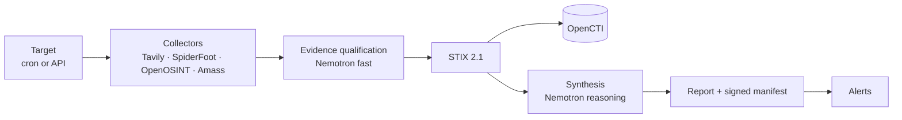

# OSINT Orchestrator

> [Español](README.es.md)

Open-source due diligence for AML/CFT compliance teams and non-financial
obliged entities: it researches an entity in public sources, qualifies what it
finds with NVIDIA Nemotron on Nebius Token Factory, and leaves a signed,
auditable report.

**Live demo:** not deployed yet · **Video:** not recorded yet (see [Roadmap](#roadmap))

## The problem

Open-source due diligence is done by hand: an analyst searches registries, news
and infrastructure data, copies results into a document and writes a
conclusion. It is slow, it does not scale to periodic re-checks, and it leaves
no trail showing which sources were consulted, what they said that day, or
whether the file was edited afterwards.

## How it works



- **Collect.** Each authorised target is researched on a schedule or on demand
  by web search (Tavily) and infrastructure collectors.
- **Qualify.** Every web result is classified against the entity: category
  (sanctions, litigation, adverse media…), relevance, confidence and a one-line
  rationale.
- **Normalise.** Findings become STIX 2.1 with deterministic ids and can be
  ingested into OpenCTI.
- **Synthesise.** A risk level with its justification, citing the evidence it
  relies on, plus what is new since the previous run.
- **Seal.** Each run's files are hashed into an HMAC-signed manifest chained to
  the previous run, so any later edit or removal is detectable.

Details: [architecture](docs/architecture.md).

## NVIDIA Nemotron on Nebius Token Factory

`LLM_PROVIDER=nebius` uses the Token Factory OpenAI-compatible endpoint. Two
model routes are configured independently:

| Route | Setting | Model used in our runs | Job | Code |
| --- | --- | --- | --- | --- |
| fast | `LLM_MODEL_FAST` | `nvidia/NVIDIA-Nemotron-3-Nano-30B-A3B` | Qualify each web result against the entity | [`synthesizer/qualify.py`](orchestrator/synthesizer/qualify.py) |
| reasoning | `LLM_MODEL_REASONING` | `nvidia/nemotron-3-super-120b-a12b` | Risk synthesis for the run | [`synthesizer/__init__.py`](orchestrator/synthesizer/__init__.py) |

Both calls request a JSON-schema response, are retried within a time budget, and
every returned value is validated before it is stored. At startup the service
checks that the configured models are served by the provider. Requests, tokens
and model availability are exported as Prometheus metrics. Provider client:
[`providers/openai_compat.py`](orchestrator/synthesizer/providers/openai_compat.py).

## Tavily

The Tavily collector ([`collectors/tavily.py`](orchestrator/collectors/tavily.py))
calls the search API at run time with three due-diligence queries per search
term: adverse media and sanctions, ownership, and legal proceedings. Terms are
the entity names configured for the target (the domain by default), quoted and
searched across third-party sources. Each distinct page becomes a STIX `url`
observable and a Note, is qualified by Nemotron, and is recorded in
`qualified_evidence.json` under the run's signed manifest.

## Quickstart

**Demo** (one container: API, demo page, Tavily and Nemotron; no OpenCTI):

```bash
cp .env.example .env    # NEBIUS_API_KEY, TAVILY_API_KEY, LLM_PROVIDER=nebius, the two LLM_MODEL_* ids, ORCHESTRATOR_API_KEY, ORCHESTRATOR_SECRET_KEY
docker compose -f docker-compose.demo.yml up -d --build
open http://localhost:7860/demo
```

Pick an entity, run an investigation, read the qualified evidence and verify
the evidence chain. The entities are an allowlist
([`demo/targets.demo.yaml`](demo/targets.demo.yaml)) and usage is limited per
visitor and per day.

**Full stack** (OpenCTI, SpiderFoot, scheduled runs, alerts; 16 GB of RAM):
`docker compose up -d --build`, then see [operations](docs/operations.md) and
[configuration](docs/configuration.md).

## Built during the hackathon

The commit `Baseline: pre-hackathon snapshot` marks what existed before: the
collection pipeline, STIX normalisation, OpenCTI ingest, reports, alerts and the
API. Added since:

| Feature | Pull requests |
| --- | --- |
| Nebius Token Factory provider, reasoning and fast model routes, bounded retries | [#1](https://github.com/careb36/osint-orchestrator-oss/pull/1), [#4](https://github.com/careb36/osint-orchestrator-oss/pull/4) |
| Tavily web-research collector, search by entity name | [#2](https://github.com/careb36/osint-orchestrator-oss/pull/2), [#3](https://github.com/careb36/osint-orchestrator-oss/pull/3), [#13](https://github.com/careb36/osint-orchestrator-oss/pull/13) |
| Evidence qualification with Nemotron, fed into the synthesis | [#29](https://github.com/careb36/osint-orchestrator-oss/pull/29), [#30](https://github.com/careb36/osint-orchestrator-oss/pull/30) |
| Signed evidence chain, one directory per run | [#23](https://github.com/careb36/osint-orchestrator-oss/pull/23), [#26](https://github.com/careb36/osint-orchestrator-oss/pull/26) |
| Startup check that the configured models are served | [#25](https://github.com/careb36/osint-orchestrator-oss/pull/25) |
| Running without OpenCTI (`OPENCTI_ENABLED=false`) | [#23](https://github.com/careb36/osint-orchestrator-oss/pull/23) |
| End-to-end fixes found by running the stack; image smoke test in CI | [#6](https://github.com/careb36/osint-orchestrator-oss/pull/6), [#16](https://github.com/careb36/osint-orchestrator-oss/pull/16), [#19](https://github.com/careb36/osint-orchestrator-oss/pull/19) |

## Responsible use

The orchestrator runs reconnaissance against whatever is listed in
`targets.yaml`, and some collectors make live requests to the target. Add only
targets you own or are authorised in writing to assess; `authorization` and
`purpose` are mandatory per target and written into every report. Model output
is an aid for an analyst, not a determination. See [SECURITY](SECURITY.md).

## Roadmap

| Item | Status |
| --- | --- |
| Evidence qualification and evidence chain | Done |
| Lightweight demo mode with usage limits | Done |
| Public deployment of the demo | Planned ([deploy guide](docs/deploy.md)) |
| Qualification of relationships between entities | Planned |
| Data-quality indicators per source | Planned |
| Document NLP (filings, court records) | Planned |
| Authoritative sources (registries, sanctions lists) | Planned |

## Documentation

[Architecture](docs/architecture.md) · [Configuration](docs/configuration.md) ·
[Operations](docs/operations.md) · [Deploy](docs/deploy.md) · [Decisions](docs/adr/) ·
[Contributing](CONTRIBUTING.md) · [Security](SECURITY.md) ·
[Changelog](CHANGELOG.md)

MIT licence — see [LICENSE](LICENSE).
