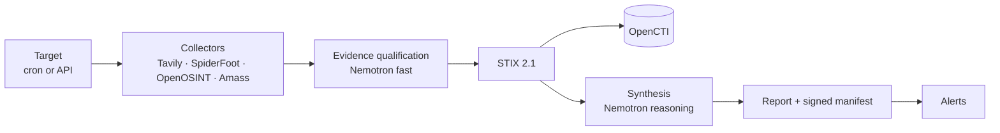

# OSINT Orchestrator

> [Español](README.es.md)

Open-source due diligence for AML/CFT compliance teams and non-financial
obliged entities: it researches an entity in public sources, qualifies what it
finds with NVIDIA Nemotron on Nebius Token Factory, and leaves a signed,
auditable report.

## The problem

Open-source due diligence is done by hand: an analyst searches registries, news
and infrastructure data, copies results into a document and writes a
conclusion. It is slow, it does not scale to periodic re-checks, and it leaves
no trail showing which sources were consulted, what they said that day, or
whether the file was edited afterwards.

## How it works



- **Collect.** Each authorised target is researched on a schedule or on demand
  by web search (Tavily) and infrastructure collectors.
- **Qualify.** Every web result is classified against the entity: category
  (sanctions, litigation, adverse media…), relevance, confidence and a one-line
  rationale.
- **Normalise.** Findings become STIX 2.1 with deterministic ids and can be
  ingested into OpenCTI.
- **Synthesise.** A risk level with its justification, citing the evidence it
  relies on, plus what is new since the previous run.
- **Seal.** Each run's files are hashed into an HMAC-signed manifest chained to
  the previous run, so any later edit or removal is detectable.

Details: [architecture](docs/architecture.md).

## NVIDIA Nemotron on Nebius Token Factory

A target opts into the Token Factory OpenAI-compatible endpoint with
`llm: nebius` in `targets.yaml` (or with `llm: openai` when
`LLM_PROVIDER=nebius`). Targets default to `llm: local`, which sends the LLM
prompts to the Ollama server at `LLM_BASE_URL` and never to a cloud LLM
provider; the prompts stay on your infrastructure only if that server does.
Two model routes are configured independently:

| Route | Setting | Model used in our runs | Job | Code |
| --- | --- | --- | --- | --- |
| fast | `LLM_MODEL_FAST` | `nvidia/NVIDIA-Nemotron-3-Nano-30B-A3B` | Qualify each web result against the entity | [`synthesizer/qualify.py`](orchestrator/synthesizer/qualify.py) |
| reasoning | `LLM_MODEL_REASONING` | `nvidia/nemotron-3-super-120b-a12b` | Risk synthesis for the run | [`synthesizer/__init__.py`](orchestrator/synthesizer/__init__.py) |

Both calls request a JSON-schema response, are retried within a time budget, and
every returned value is validated before it is stored. The startup check that
the configured models are served follows the global setting, not the target's
`llm`: it runs only with `LLM_PROVIDER=nebius` and `NEBIUS_API_KEY` set, so a
deployment that opts in with `llm: nebius` alone gets no startup check.
Requests, tokens and model availability are exported as Prometheus metrics.
Provider client:
[`providers/openai_compat.py`](orchestrator/synthesizer/providers/openai_compat.py).

## Tavily

The Tavily collector ([`collectors/tavily.py`](orchestrator/collectors/tavily.py))
calls the search API at run time with three due-diligence queries per search
term: adverse media and sanctions, ownership, and legal proceedings. Terms are
the entity names configured for the target (the domain by default), quoted and
searched across third-party sources. Each distinct page becomes a STIX `url`
observable and a Note, is qualified by Nemotron, and is recorded in
`qualified_evidence.json` under the run's signed manifest.

## Quickstart

The full stack (OpenCTI, SpiderFoot, scheduled runs, alerts) needs Docker with
Compose v2.20+ and 16 GB of RAM:

```bash
cp .env.example .env                    # passwords, tokens and API keys it lists
cp targets.example.yaml targets.yaml    # only targets you are authorised to assess
# Set OPENCTI_ENABLED=true in .env for the full stack.
docker compose --profile opencti up -d --build
```

For a lightweight install, keep `OPENCTI_ENABLED=false` (the `.env.example`
default) and run `docker compose up -d --build`: only SpiderFoot and the
orchestrator start. Existing sink-on installs must add `--profile opencti`
or set `COMPOSE_PROFILES=opencti` in `.env`.

Then see [operations](docs/operations.md), [configuration](docs/configuration.md)
and, for a server, [deploy](docs/deploy.md).

**Operator dashboard:** <http://localhost:8000/console>, in Spanish or English.
Key figures, targets ordered by what needs attention, active runs, findings,
evidence with search and filters, and a Start-run action; it asks for
`ORCHESTRATOR_API_KEY` on first load. Source in [`ui/`](ui/README.md); the
images build it, so nothing else is needed.

## Built during the hackathon

The commit `Baseline: pre-hackathon snapshot` marks what existed before: the
collection pipeline, STIX normalisation, OpenCTI ingest, reports, alerts and the
API. Added since:

| Feature | Pull requests |
| --- | --- |
| Nebius Token Factory provider, reasoning and fast model routes, bounded retries | [#1](https://github.com/careb36/osint-orchestrator-oss/pull/1), [#4](https://github.com/careb36/osint-orchestrator-oss/pull/4) |
| Tavily web-research collector, search by entity name | [#2](https://github.com/careb36/osint-orchestrator-oss/pull/2), [#3](https://github.com/careb36/osint-orchestrator-oss/pull/3), [#13](https://github.com/careb36/osint-orchestrator-oss/pull/13) |
| Evidence qualification with Nemotron, fed into the synthesis | [#29](https://github.com/careb36/osint-orchestrator-oss/pull/29), [#30](https://github.com/careb36/osint-orchestrator-oss/pull/30) |
| Signed evidence chain, one directory per run | [#23](https://github.com/careb36/osint-orchestrator-oss/pull/23), [#26](https://github.com/careb36/osint-orchestrator-oss/pull/26) |
| Startup check that the configured models are served | [#25](https://github.com/careb36/osint-orchestrator-oss/pull/25) |
| Running without OpenCTI (`OPENCTI_ENABLED=false`) | [#23](https://github.com/careb36/osint-orchestrator-oss/pull/23) |
| End-to-end fixes found by running the stack; image smoke test in CI | [#6](https://github.com/careb36/osint-orchestrator-oss/pull/6), [#16](https://github.com/careb36/osint-orchestrator-oss/pull/16), [#19](https://github.com/careb36/osint-orchestrator-oss/pull/19) |
| Operator dashboard (React): shell, overview, targets and runs triage, run workspace with evidence, report, manifest and handoff export, run history, Spanish and English, accessibility checks | [#67](https://github.com/careb36/osint-orchestrator-oss/pull/67), [#68](https://github.com/careb36/osint-orchestrator-oss/pull/68), [#69](https://github.com/careb36/osint-orchestrator-oss/pull/69), [#70](https://github.com/careb36/osint-orchestrator-oss/pull/70), [#71](https://github.com/careb36/osint-orchestrator-oss/pull/71), [#75](https://github.com/careb36/osint-orchestrator-oss/pull/75), [#76](https://github.com/careb36/osint-orchestrator-oss/pull/76), [#77](https://github.com/careb36/osint-orchestrator-oss/pull/77) |
| Dashboard scaffold, scope, KPIs and definition of done; production-readiness telemetry and smoke flow | [#45](https://github.com/careb36/osint-orchestrator-oss/pull/45), [#47](https://github.com/careb36/osint-orchestrator-oss/pull/47), [#57](https://github.com/careb36/osint-orchestrator-oss/pull/57), [#58](https://github.com/careb36/osint-orchestrator-oss/pull/58), [#60](https://github.com/careb36/osint-orchestrator-oss/pull/60), [#61](https://github.com/careb36/osint-orchestrator-oss/pull/61), [#62](https://github.com/careb36/osint-orchestrator-oss/pull/62), [#64](https://github.com/careb36/osint-orchestrator-oss/pull/64) |
| Public demo mode, later retired together with the server-rendered console | [#33](https://github.com/careb36/osint-orchestrator-oss/pull/33), [#35](https://github.com/careb36/osint-orchestrator-oss/pull/35), [#65](https://github.com/careb36/osint-orchestrator-oss/pull/65), [#73](https://github.com/careb36/osint-orchestrator-oss/pull/73), [#74](https://github.com/careb36/osint-orchestrator-oss/pull/74) |
| Integrity fixes (evidence chain, retention) and hardening of model and internet-derived text | [#66](https://github.com/careb36/osint-orchestrator-oss/pull/66), [#78](https://github.com/careb36/osint-orchestrator-oss/pull/78) |

## Responsible use

The orchestrator runs reconnaissance against whatever is listed in
`targets.yaml`, and some collectors make live requests to the target. Add only
targets you own or are authorised in writing to assess; `authorization` and
`purpose` are mandatory per target and written into every report. Model output
is an aid for an analyst, not a determination. See [SECURITY](SECURITY.md).

## Roadmap

| Item | Status |
| --- | --- |
| Evidence qualification and evidence chain | Done |
| Operator dashboard (overview, triage, investigation) | Done |
| Qualification of relationships between entities | Planned |
| Data-quality indicators per source | Planned |
| Document NLP (filings, court records) | Planned |
| Authoritative sources (registries, sanctions lists) | Planned |

## Documentation

[Architecture](docs/architecture.md) · [Configuration](docs/configuration.md) ·
[Operations](docs/operations.md) · [Deploy](docs/deploy.md) · [Decisions](docs/adr/) ·
[Contributing](CONTRIBUTING.md) · [Security](SECURITY.md) ·
[Changelog](CHANGELOG.md)

MIT licence — see [LICENSE](LICENSE).
