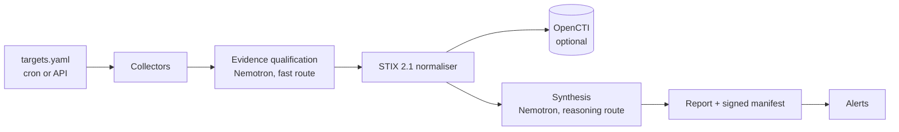

# Architecture

OSINT Orchestrator is one FastAPI process with an in-process scheduler
(APScheduler) and a SQLite database for operational state. It drives external
collectors, normalises what they find to STIX 2.1, and produces a signed,
reviewable report per run.

## Professional workflow

[ADR-012](adr/ADR-012-personal-compliance-workflow.md) adds personal identities,
server-side sessions and shared-practice professional dossiers above source runs.
SQLite holds identities, review events, immutable snapshots and final PDFs.
See the [workflow and upgrade guide](compliance-workflow.md).

## Pipeline

One run, in order (`orchestrator/pipeline.py`):

1. **Collect.** Each enabled collector returns a `CollectorResult`; raw tool
   output never leaves the collector module.
2. **Qualify.** Web results are classified against the entity under review
   (category, relevance, confidence, rationale) on the fast model route.
3. **Normalise and ingest.** Results become STIX 2.1 objects with deterministic
   ids and are pushed to OpenCTI. Failed bundles go to an outbox and are retried.
   Which OASIS best practices shape those objects, and the few this project
   deliberately does differently, are recorded in
   [STIX best practices](stix-best-practices.md).
4. **Delta.** Observables not seen before for the target are marked new.
5. **Synthesise.** The reasoning model writes a summary, a risk level with its
   justification, and suggested pivots, citing the qualified evidence it uses.
6. **Report and seal.** The run directory gets the report, the STIX bundle, the
   delta, the qualified evidence and a signed manifest chained to the target's
   previous run.
7. **Alert.** Webhook and e-mail, according to the target's rules.

## Components

| Module | Responsibility |
| --- | --- |
| `api.py`, `auth.py` | REST API, API-key authentication, serving of the operator dashboard (`ui/`, React, built into the image) |
| `scheduler.py` | Cron jobs built from `targets.yaml`, retry workers, retention |
| `collectors/` | OpenOSINT (in-process), SpiderFoot (HTTP), Tavily (HTTP), Amass and SocialOSINT (opt-in sidecars) |
| `normalizer/stix.py` | The only place STIX objects are built |
| `sinks/` | OpenCTI ingest through pycti, transient-only retries |
| `synthesizer/` | LLM providers (Nebius, OpenAI-compatible, Anthropic, Ollama), model routing, evidence qualification, synthesis |
| `reports/`, `evidence.py` | Run artefacts and the signed manifest chain |
| `alerts/` | Webhook and SMTP dispatch with a retry queue |
| `i18n.py` | Operator-facing text in Spanish and English |

## LLM routing

The provider is chosen per target by the `llm` field of `targets.yaml`
(`synthesizer/providers/__init__.py`). `local`, the default, is always the
Ollama server at `LLM_BASE_URL`, so a target's LLM prompts reach a cloud LLM
provider only when the target opts in. They stay on the operator's
infrastructure only if that Ollama server does.
`LLM_PROVIDER` is a global switch, not a default: `none` disables synthesis
everywhere, `nebius` routes `llm: openai` targets to Token Factory, and
`openai` or `nebius` selects the provider the startup model check queries.

Two routes share one provider client
(`synthesizer/providers/openai_compat.py`, `synthesizer/model_routing.py`):

| Route | Setting | Used for | Code |
| --- | --- | --- | --- |
| fast | `LLM_MODEL_FAST` | Evidence qualification, batches of 5; unqualified items are retried once | `synthesizer/qualify.py` |
| reasoning | `LLM_MODEL_REASONING` | Run synthesis | `synthesizer/__init__.py` |

Both request a JSON-schema response and fall back once to a plain request when
the provider rejects `response_format`. Calls are retried on 408, 409, 429, 5xx
and transport errors inside `LLM_TIMEOUT_SECONDS`. Every value returned by a
model is validated before it is stored; an invalid item is dropped and counted,
it never fails the run. Collected text is passed to the models as delimited,
flattened, untrusted data.

## Operator dashboard

`ui/` is a React + TypeScript single-page application built with Vite. The
`Dockerfile` builds it in a `node` stage and copies `ui/dist` into
`orchestrator/static/ui-dist`; `api.py` serves it under `/console` (the shell,
`/console/assets/*` with immutable caching, and a catch-all for the client
routes) and answers 503 with the build steps when the directory is missing.
Every data call goes to the same REST API through one typed client
(`ui/src/lib/api.ts`), so the dashboard has no state of its own: the backend
stays the source of truth for runs, findings and evidence (ADR-003).

Access is layered. The shell is public; browser operators sign in with a
personal account ([ADR-012](adr/ADR-012-personal-compliance-workflow.md)) and
the server keeps an `HttpOnly`, `SameSite=Strict` session cookie whose token is
stored only as a SHA-256 digest. Roles are `admin` (accounts and the
operational routes) and `accountant` (evidence decisions, dossier conclusion,
report issuance). The boundary the code enforces is narrower than
"four eyes": only an accountant may decide, and an administrator may not, but
nothing stops the accountant who triggered a run from signing that same run off
later, so keeping collection and approval apart is a procedure, not a control.
Automation keeps the static API key
([ADR-005](adr/ADR-005-api-auth-and-single-instance.md)), which the scheduler
and scripts send as `X-API-Key` or a bearer token, and which opens the
operational routes but not `/accounts` or `/cases`; `/auth/status` tells the
console whether personal accounts exist yet, and until an
administrator is provisioned the console asks for that static key instead,
keeping it in `sessionStorage` (or `localStorage` when the operator asks to be
remembered). An install with neither a key nor an account lets legacy routes
through anonymously. Mutating browser requests must carry
`X-Requested-With: XMLHttpRequest` and, when `Origin` is present, match the
request's own origin (`orchestrator/accounts.py::check_browser_request`), which
is what replaces a CSRF token now that a cookie carries the session. The shell
is served with a `Content-Security-Policy` that
allows nothing by default and only same-origin scripts, styles, connections,
images and fonts (`default-src 'none'; script-src 'self'; style-src 'self';
connect-src 'self'; img-src 'self' data:; font-src 'self'; base-uri 'none';
form-action 'none'; frame-ancestors 'none'`, see `orchestrator/api.py`) and no
inline script, which CI checks on the built `index.html`. Text follows ADR-004: Spanish by default with an
English switch, one catalogue with parity enforced by a test. The scope, KPIs
and phased definition of done are in `ui/docs/`; the decision is ADR-010.

## Decisions

| ADR | Decision |
| --- | --- |
| [001](adr/ADR-001-modular-monolith.md) | Modular monolith |
| [002](adr/ADR-002-stix-as-contract.md) | STIX 2.1 as the internal data contract |
| [003](adr/ADR-003-opencti-as-store.md) | OpenCTI as the single source of truth for observables |
| [004](adr/ADR-004-language-policy.md) | Spanish for operators, English for code |
| [005](adr/ADR-005-api-auth-and-single-instance.md) | Static API keys, structured observability, single instance |
| [006](adr/ADR-006-oidc-proxy.md) | Optional OIDC proxy as a perimeter layer |
| [007](adr/ADR-007-evidence-chain.md) | Signed per-run evidence manifests chained per target |
| [008](adr/ADR-008-optional-opencti-sink.md) | The OpenCTI sink can be disabled |
| [009](adr/ADR-009-documentation-language.md) | Documentation in English, README in English and Spanish |
| [010](adr/ADR-010-operator-dashboard.md) | Operator dashboard as a React SPA served by the API, API-key access |
| [011](adr/ADR-011-external-stix-producers.md) | External STIX 2.1 producers as an intake path (`ingest_bundle`, `POST /bundles`) |
| [012](adr/ADR-012-personal-compliance-workflow.md) | Personal compliance workflow: identities, accounts, dossiers, immutable report versions |
| [013](adr/ADR-013-openosint-fork-and-upstream-drift.md) | OpenOSINT fork pin, and explicit monitoring of the three pins Dependabot cannot see |

## Third-party tools

| Tool | How it is used |
| --- | --- |
| [OpenOSINT](https://github.com/careb36/OpenOSINT) | Python API, pinned by commit to a fork that ships `investigate()` |
| [SpiderFoot](https://github.com/smicallef/spiderfoot) | Built from source as `spiderfoot:local`, driven over its web API |
| [Tavily](https://tavily.com) | Search API, called at run time for due-diligence queries |
| [OWASP Amass](https://github.com/owasp-amass/amass) | Engine sidecar `owaspamass/amass:v5.1.1`, results read with `oam_subs` |
| [OWASP SocialOSINT](https://github.com/bm-github/owasp-social-osint-agent) | Sidecar service, official platform APIs only |
| [OpenCTI](https://github.com/OpenCTI-Platform/opencti) | `opencti/platform:7.260811.0-lts.1` (LTS); `pycti` is pinned to the matching release, `7.260811.0.1` |
| MISP | Through the official OpenCTI connector; no custom code |
